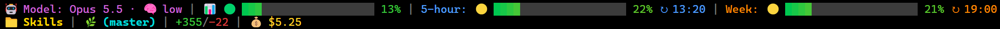

# Skills

Agent skills for Claude Code.

## Installation

```bash
npx skills add LordTyberias/Skills
```

## Included skills

| Skill | Purpose |
| --- | --- |
| [review-agents-setup](skills/review-agents-setup/SKILL.md) | Generates a mandatory pre-pull-request review loop tailored to the repository it runs in. |
| [repo-security-hardening](skills/repo-security-hardening/SKILL.md) | Runs a full security review of a repository in one pass: inventory first, then only the checks that fit, ending in a report with change proposals. |
| [gradient-statusline](skills/gradient-statusline/SKILL.md) | Installs or adjusts a two-line truecolor status line with gradient usage bars, in the user's language and with a user-chosen segment order. |

### review-agents-setup

Run in the repository you want to protect. The skill first inspects the project — stack, module
manifests, rule documents, real build/test/lint commands, default branch, and any review setup that
already exists — asks about everything it cannot determine, and only then writes files whose rules
are quoted from that repository. Nothing is generic, and no existing file is overwritten without a
decision.

It installs one orchestrator command and three reviewer agents:

| File | Role |
| --- | --- |
| `.claude/commands/review-loop.md` | The orchestrator. Collects the full branch diff including uncommitted and untracked work, spawns every configured reviewer in parallel each iteration, parses their JSON verdicts, applies only justified fixes, runs the project's real verification commands, and repeats until every reviewer approves or the iteration limit is hit. It is the only participant allowed to change files or ask the user. |
| `.claude/agents/architect-reviewer.md` | Architecture and structure: module assignment of new code, dependency direction down to the manifest level, technology boundaries, established patterns, persistence boundaries, new dependencies, and the ADR obligation. Every finding must quote a real rule location; findings have no severity — they all block. |
| `.claude/agents/code-reviewer.md` | Correctness, readability, duplication, error handling, async and cancellation, logging, tests, documentation, migrations, and breaking changes — judged against the project's own documented conventions. Severities `must-fix` / `should-fix` / `nice-to-have`. |
| `.claude/agents/security-reviewer.md` | Secrets, sensitive data in logs, injection, path traversal, authentication and authorization gaps, TLS and crypto, unvalidated input, unsafe migration or restore behavior, insecure storage, and dependency risk — each finding naming a concrete attack path. `critical` and `high` block unconditionally. |

Two further reviewers are written only if you opt in:

| File | Role |
| --- | --- |
| `.claude/agents/performance-reviewer.md` | Structurally certain performance defects only — query patterns that scale with row count, work on the wrong thread, allocation growth in hot paths, unbounded concurrency. Every finding names the input that makes it hurt; speculative micro-optimization is not a finding. |
| `.claude/agents/requirements-reviewer.md` | Checks the diff against the specification it claims to implement: missing or contradicted specified behavior, quoting the document and section. Offered only when the repository actually has a binding specification to cite. |

The reviewers are read-only and cannot modify anything or talk to the user. Their scopes are kept
disjoint so two of them never demand opposite edits on the same line, and the loop declares two
explicit orders: authority (`security > architect > requirements > code > performance`) decides who
wins a contradiction, application (`architect → requirements → security → performance → code`)
decides the sequence fixes are applied in.

Finally the skill anchors the loop as a hard rule in the repository's `CLAUDE.md` — edited
surgically, never rewritten — so the next agent that opens the project cannot skip it: `/review-loop`
is mandatory before every pull request, the local agents may not be substituted by generic ones, and
security `critical` / `high` findings can never be waived.

### repo-security-hardening

Run in the repository you want to check. The skill first writes an inventory — languages, projects,
dependencies, known vulnerabilities, analysis setup, risky code patterns, CI, and installed tools —
and derives from it which checks are worth running: analyzer measurement, dependency audits per
ecosystem (NuGet, npm, yarn, pnpm, Python, Java, Go, Rust, Ruby, PHP, containers), shipped binaries,
Semgrep and language-native security linters, secret scan, GitHub settings, Dependabot and
workflows, an attack surface review (with dedicated checklists for Angular/React SPAs and SSR
frameworks like Next.js), and a threat model for planned features. It stops once to confirm the plan and any
tool installs, then runs through and ends with a security report and proposal files.

The whole run happens in Claude Code's plan mode, which the skill enters as its first step; without
plan mode it does not run. The repository stays untouched: everything is written to a work dir
outside it (`~/security-reviews/<repo>/<date>-<branch>/`), secret values are never printed, and
nothing is installed or posted without consent. At the end, a multiple-choice round first asks
whether to apply anything at all, then lets you pick the changes; the plan approval of plan mode
starts the implementation, and each selected change becomes its own commit on a separate branch.
If the `grill-with-docs` skill is installed, the round runs through it, and rejected changes can be
recorded as ADRs. Works
on Windows (PowerShell) and Linux/macOS (Bash); .NET gets the deepest coverage.

### gradient-statusline

For Claude Code only. Install it for Claude Code alone, globally:

```bash
npx skills add LordTyberias/Skills -g -s gradient-statusline -a claude-code
```



It installs a two-line Claude Code status line: context window, 5-hour and weekly usage as 20-cell
gradient bars with emoji and reset times, the model with its effort level, repo, branch, lines
changed and session cost. The skill asks for the language of the labels (defaulting to the
`language` setting) and which segments go in the top and bottom row, in which order, or whether to
hide some or use a single row.

An existing status line is never replaced silently. If it is this one, the skill reads its current
language and layout and changes only the config block at the top of the script. If it is a different
one, the skill summarizes what it shows and offers a choice: back it up and replace it, or
overwrite it. A backup goes to `~/.claude/statusline-command.sh.bak-<timestamp>`, and the final
report explains step by step how to restore the old status line, with the exact path, copy command
and previous `statusLine` value. Only the `statusLine` key in
`~/.claude/settings.json` is touched. Needs `bash` (Git Bash on Windows), `node`, `awk` and `git`.
To show the effort level auto-effort-picker holds as `<level> (auto)`, install both
[auto-effort-picker](#auto-effort-picker) and [effort-statusline-bridge](#effort-statusline-bridge);
the bridge alone never shows `(auto)`. Without them the status line shows the menu level.

## Plugins

| Plugin | Purpose |
| --- | --- |
| [auto-effort-picker](plugins/auto-effort-picker) | Picks the effort level each prompt needs before Claude starts. For `/ticket` and `/repo-security-hardening`, it judges the work first and the approved plan again. |
| [effort-statusline-bridge](plugins/effort-statusline-bridge) | Lets a status line script show the level auto-effort-picker holds as `<level> (auto)`. |

### auto-effort-picker

Before Claude starts on a prompt, a short Sonnet 5.5 call reads the prompt and picks Low, Medium,
High, Extra high or Max with four questions, stopping at the first yes: back and forth or simple
(Low), a hidden mistake would be costly (High), a long, hard and critical hand-off (Extra high),
everything else (Medium). Slash commands are skipped, with two exceptions. For `/ticket` the pick
waits until `mcp__youtrack__get_issue` has returned the ticket and judges the ticket text. For
`/repo-security-hardening` it judges the security review itself. In both, the plan approved with
`ExitPlanMode` is judged again and sets the level for the build. Such a run holds across the questions
and answers in between (for the security review: stop 1 and the selection round) and ends with the
next run or a new conversation. Any other slash command releases a level the plugin holds. Short approvals (yes, ok, go, option 2)
keep the level without a pick. In suggest mode a dialog asks before switching; in auto mode the level
is set by itself.

Commands: `/auto-effort-picker` or `/auto-effort-picker status` (picker level, sent level, hold),
`/auto-effort-picker reset` (release the hold), `/auto-effort-picker log` (the plugin's log), `/auto-effort-picker auto`, `/auto-effort-picker suggest`,
`/auto-effort-picker off`, `/auto-effort-picker on`.

What the plugin changes and writes:

- **Settings and environment:** none. It changes no setting, no environment variable and no file
  that other tools run or obey. The level it picks is put only on the `effort` field of the main
  chat's own requests.
- **Files it writes:** none. Its log (picks, sent levels and errors, the last 20 KB) is kept in the
  plugin's own store in Claude Code and shown by `/auto-effort-picker log`.
- **Files it reads:** `~/.claude/mods/switches.json`, the `/mods` switchboard, to know whether it is turned off.

What its hooks do:

- `prompt.submit`: reads the prompt to decide whether to pick; never changes the prompt.
- `turn.step`: reads each main-chat request's effort level and replaces it with the picked one; nothing else
  in the request is changed. Subagent requests are not touched.
- `tool.call` on `mcp__youtrack__get_issue`, `mcp__youtrack__update_issue` and `ExitPlanMode`: reads the
  result after the tool ran, to pick from the ticket or the approved plan; never changes the call or its result.
- `command.run`: answers `/auto-effort-picker`. `ui.render` and `ui.press`: draw the band above the
  prompt and the footer label.

Links: [Documentation](https://github.com/LordTyberias/Skills#auto-effort-picker) · [Support](https://github.com/LordTyberias/Skills/issues) · [Privacy](https://github.com/LordTyberias/Skills/blob/master/plugins/auto-effort-picker/PRIVACY.md)

Install:

```
/plugin marketplace add LordTyberias/Skills
/plugin install auto-effort-picker@lordtyberias-skills
```

### effort-statusline-bridge

Status line scripts get the menu level in `effort.level`, not the level auto-effort-picker puts on the
request. This plugin writes that held level to
`~/.claude/mods-state/effort-statusline-bridge/<session id>.json` as `{"line":"high"}`, or
`{"line":""}` when auto-effort-picker holds none. auto-effort-picker itself is not changed and works
without it.

- **Files it writes:** the one file per session above. Files of ended sessions stay, with an empty line.
- **Files it reads:** none. It reads the `override` state of auto-effort-picker.
- **Hooks:** `turn.step` and `state.set` on that `override` read the held level; `session.start` and
  `session.end` reset and clear the file. Nothing in any request is changed.

Status line snippet (Node, inside a script that has the status line JSON in `j`):

```js
const lvl = j.effort?.level ?? ""
let effort = lvl
try {
  const f = require("path").join(require("os").homedir(), ".claude", "mods-state",
    "effort-statusline-bridge", j.session_id + ".json")
  const held = JSON.parse(require("fs").readFileSync(f, "utf8")).line
  if (held && held !== lvl) effort = held + " (auto)"
} catch {}
```

Install:

```
/plugin marketplace add LordTyberias/Skills
/plugin install effort-statusline-bridge@lordtyberias-skills
```

## License

GPL-3.0-only, see [LICENSE](LICENSE).
